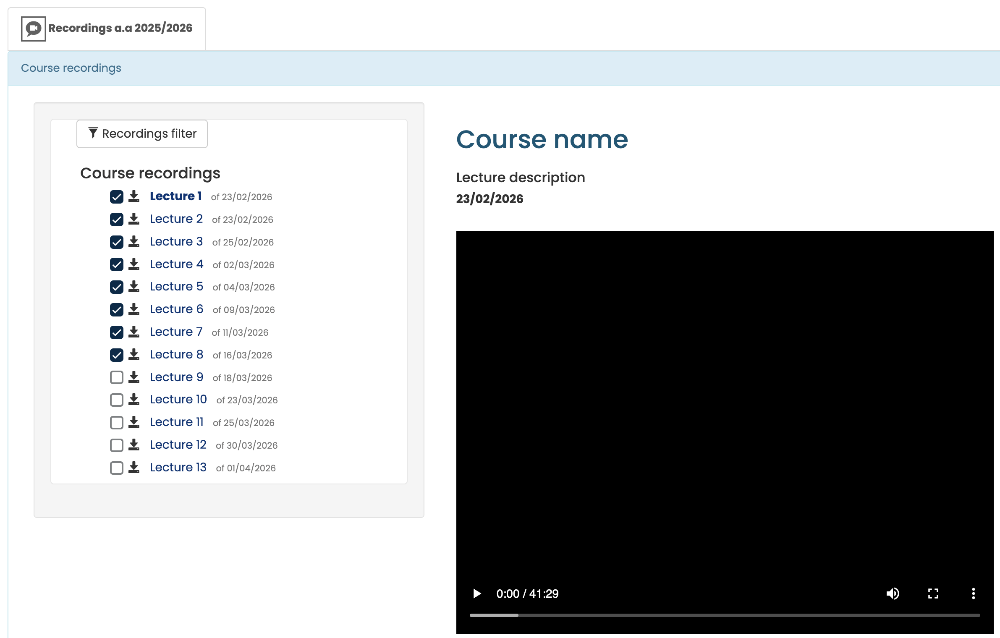

# Download your PoliTo lectures

A Tampermonkey userscript for [Politecnico di Torino](https://didattica.polito.it) virtual classroom pages that adds:

- **Download buttons** to save lecture videos as `.mp4` files
- **Completion checkboxes** next to each lecture

### Preview

## Installation

1. Install [Tampermonkey](https://www.tampermonkey.net/) in your browser
2. Enable **User Scripts** for Tampermonkey in your browser's extension settings (in Chrome: [chrome://extensions](chrome://extensions) 👉🏻 Tampermonkey 👉🏻 `Details` 👉🏻 `Allow User Scripts`)
3. Click on the `polito-download-lectures.user.js` file in this repo, then click **Raw** — Tampermonkey will prompt you to install it
